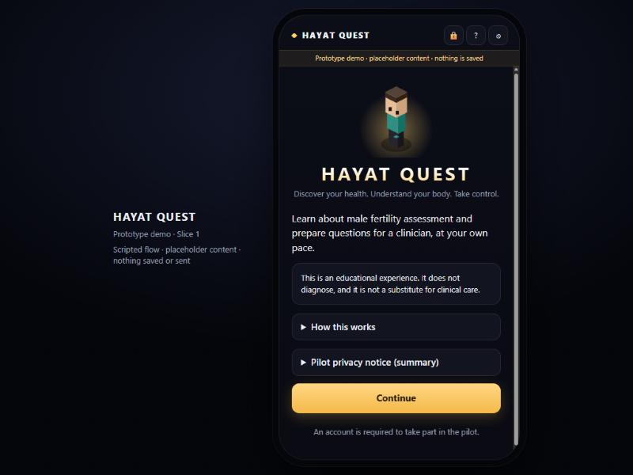
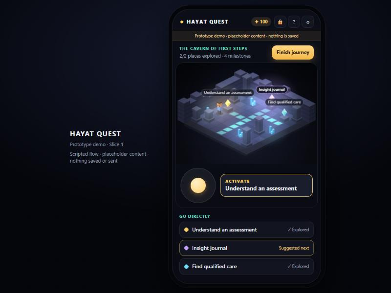
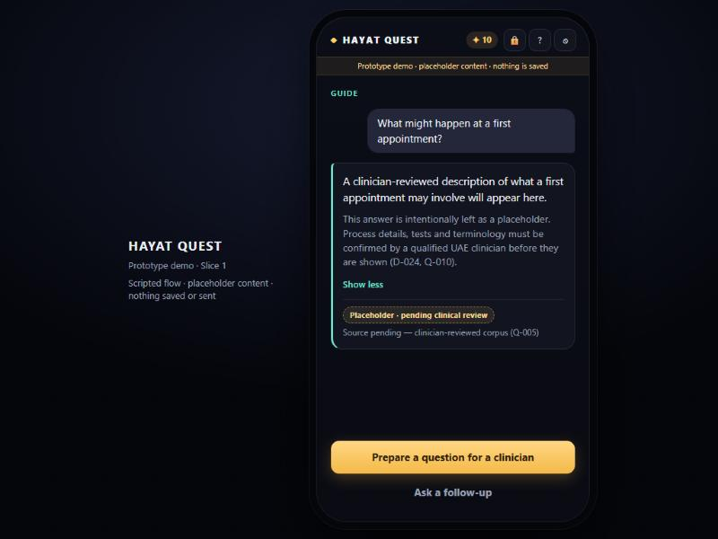
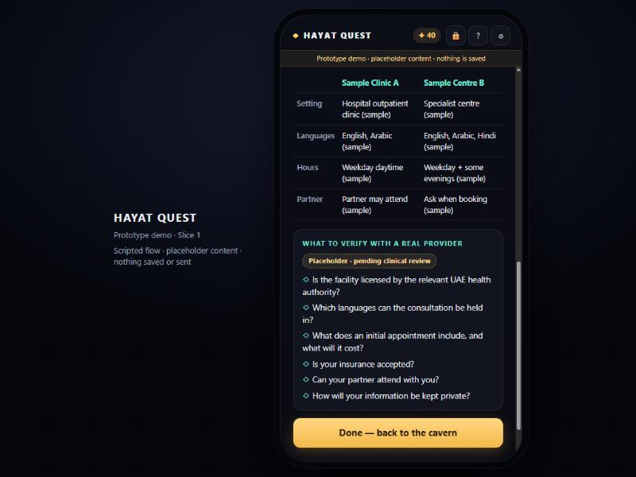

# HAYAT QUEST

**Discover your health. Understand your body. Take control.**

HAYAT QUEST is an innovation prototype: a private, culturally comfortable men's reproductive-health education and care-navigation experience for the UAE. It pairs a calm, game-inspired journey with an AI guide that helps a hesitant user understand what a male fertility assessment may involve, prepare questions for a clinician, and find a sensible next step.

> **Prototype notice:** all health-related copy in this repository is clearly labelled placeholder text, **pending review by a qualified clinician**. Care listings are fictional. Nothing here is medical advice, and the app never diagnoses, interprets results or recommends treatment.

| Welcome | Guided cavern scene |
|---|---|
|  |  |
| **Answer card with review label** | **Fictional care comparison** |
|  |  |

## What's in the prototype

- **One end-to-end journey (15 screens):**
  - consent-first onboarding with optional data choices, all off by default
  - avatar, starting point and before/after self-ratings
  - a mission on understanding an assessment
  - preparing questions for a clinician
  - comparing fictional care options
- **An original isometric scene**, drawn entirely in code on an HTML canvas: a softly lit cavern with glowing paths. Move with a virtual joystick or the keyboard, walk up to a beacon and press Activate. A plain list offers the same places, so movement is never required.
- **Privacy by default:**
  - journey state lives only in memory and clears on reload
  - no analytics, no browser storage
  - chat history, personalisation and journal saving are each separate opt-ins
- **Bounded AI, demo only.** An internal *Presenter lab* calls Azure AI Foundry (gpt-5.4-mini) through a server. The browser can only send the ID of a fixed, synthetic, non-health prompt, so free text and health details can't reach the model.

## Architecture

```text
Browser (React + canvas)  ──/api──►  Node API (Fastify)  ──►  Azure AI Foundry · Responses API (store: false)
                                         │
                                         └──► Application Insights (metadata + timing only, redacted)
```

Guardrails are enforced in code and tests. See [docs/ARCHITECTURE.md](docs/ARCHITECTURE.md).

| Guardrail | Where |
|---|---|
| `store: false` on every model call; no threads or response chaining | `server/src/ai/responses.ts`, `guardrails.test.ts` |
| Allow-listed prompt IDs only; unknown fields rejected and never echoed | `server/src/app.ts`, `app.test.ts` |
| Telemetry keeps only allow-listed attributes; no bodies, queries or emails | `server/src/telemetry.ts`, `telemetry.test.ts` |
| No endpoints or keys in the browser bundle | `scripts/check-bundle.mjs` |
| Keyless Azure (managed identity), 30-day log retention, isolated resource group | `infra/*.bicep` |

## Run it locally

```bash
npm --prefix app install
npm --prefix app run dev          # demo journey → http://localhost:5173
```

Presenter lab (offline fixture mode, no Azure needed):

```bash
npm --prefix server install
npm --prefix app run build
npm --prefix server run dev:lab   # client + API → http://localhost:8787 (Help → For presenters)
```

## Tech
React 18 · TypeScript · Vite · Canvas 2D · Fastify · Vitest · OpenAI SDK (Azure) · Azure Monitor OpenTelemetry · Bicep

## Status
A presentation prototype. Clinical review, real sign-in (Microsoft Entra External ID) and a limited pilot are future steps. This repository is a curated public snapshot; planning documents are kept privately.
